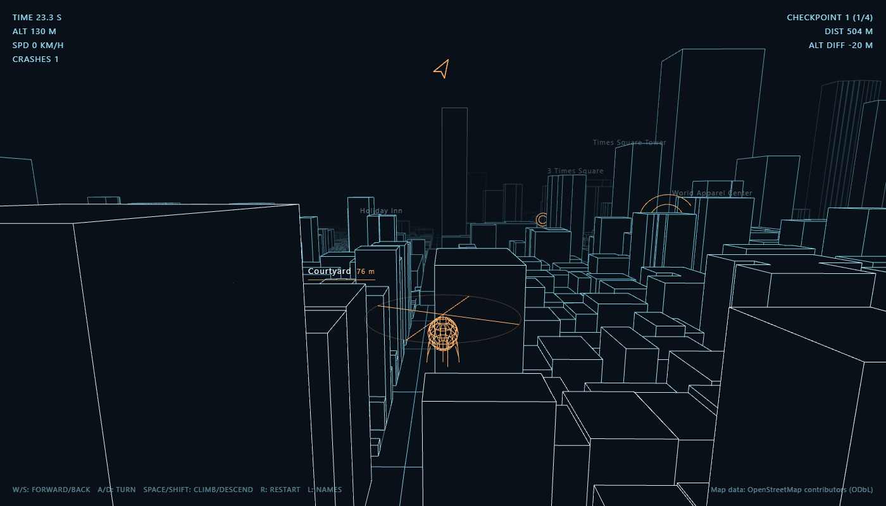

# Manhattan Heli

A line-art helicopter game. Fly over Midtown Manhattan, Lower Manhattan, Paris, and Tokyo. Avoid the buildings. Reach the destination.

The buildings, roads, and parks come from real map data.



## Run

The project uses Node.js 22.

```
npm install
npm run dev
```

Open the address that the command prints. Press 1 to 4 to select a stage. Press ENTER to start.

## Controls

| Key | Action |
|---|---|
| W / S | Fly forward and back |
| A / D | Turn left and right |
| SPACE / SHIFT | Climb and descend |
| R | Restart the mission |
| L | Show or hide building names |
| 1 to 4 | Select a stage on the title screen |
| ESC | Stop the mission and go back to the title screen |

## Verify

```
npm run verify
```

The command checks the requirements, the text rules, the types, the unit tests, and the end-to-end test. The end-to-end test needs Chrome or Edge. Set `CHROME_PATH` if the test cannot find the browser.

## Deploy

GitHub Actions deploys the game to GitHub Pages. The pipeline runs `npm run verify` first. It deploys only if all checks pass.

Set up once: open the repository settings, open Pages, and set Source to GitHub Actions.

The site address is https://choonsik.github.io/game/.

The pipeline also deploys to Vercel. Add the repository secrets `VERCEL_TOKEN`, `VERCEL_ORG_ID`, and `VERCEL_PROJECT_ID`. Without them, the Vercel job skips itself. Do not connect the repository with the Vercel Git integration, because it deploys without verification.

## Spec

The spec, the requirements, and the change rules are in [docs/spec/SPEC.md](docs/spec/SPEC.md). The spec, the tests, and the code share one version number.

## Data and credit

Map data: OpenStreetMap contributors. The data is available under the [Open Database License (ODbL) 1.0](https://opendatacommons.org/licenses/odbl/1-0/).

Each file in `public/data/` is a derived database. Run `npm run fetch-osm` to make them again. To make one stage only, add the stage ID, for example `npm run fetch-osm -- paris`. The stage list is in `src/stages.json`. See [NOTICE.md](NOTICE.md).

## License

The code is under the MIT license. See [LICENSE](LICENSE). The map data is under the ODbL.
